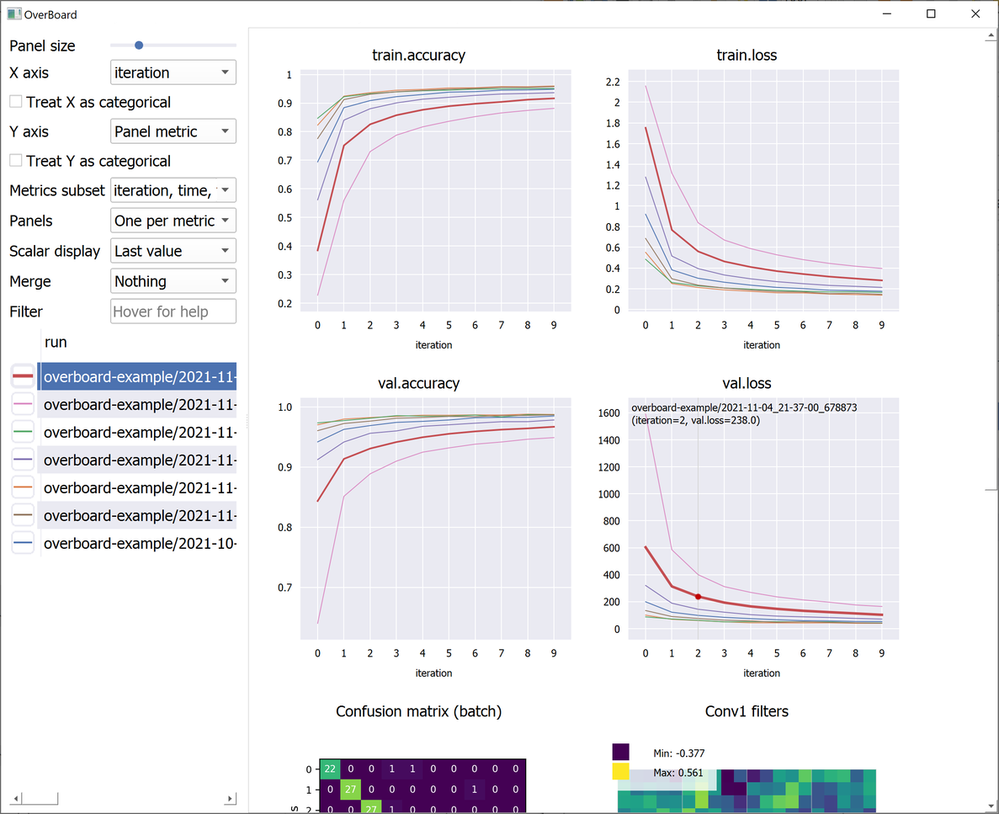
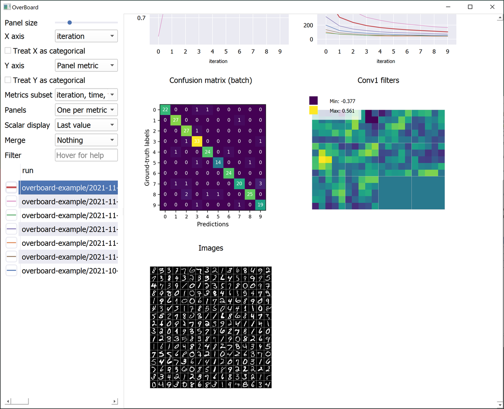
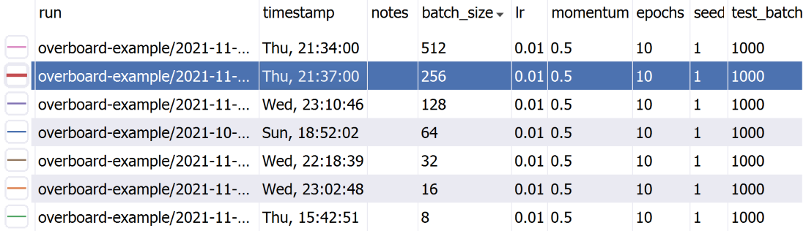
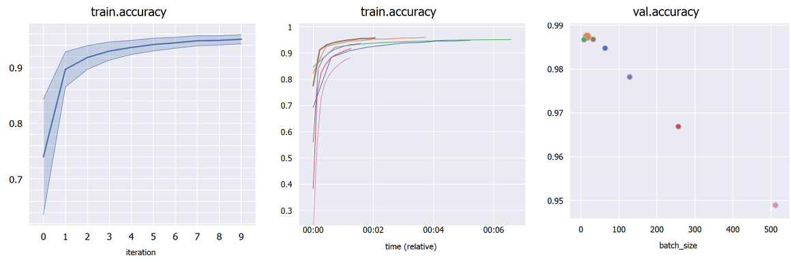

# OverBoard

OverBoard is a lightweight and powerful dashboard for monitoring, visualizing, and analyzing machine learning experiments in real time.

## Features

- Real-time monitoring of local and remote experiments through SSH and FTP.
- Custom visualizations using tensors, Matplotlib, and PyQtGraph.
- Sortable hyperparameter tables with Python-based filtering.
- Percentile intervals and shaded plots.
- Custom X and Y axes.
- Hyperparameter comparison using bubble plots.
- Interactive 2D and 3D visualizations.
- Experiment grouping and comparison.
- Lightweight experiment logging.

## Screenshots

### Real-Time Experiment Monitoring



### Custom Visualizations



### Hyperparameter Management



### Advanced Plotting



## Installation

Install the required dependencies using Conda:

```bash
conda install pyqt=5.12 pyqtgraph=0.11 -c conda-forge
```

Alternatively, install them using pip:

```bash
pip install pyqt5==5.12 pyqtgraph==0.11
```

Install OverBoard:

```bash
pip install fs==2.4 overboard
```

Using pip is recommended for installing the filesystem dependency.

### Optional Dependencies

For remote SSH connections:

```bash
pip install fs.sshfs
```

For custom 3D visualizations:

```bash
pip install PyOpenGL==3.1.0
```

For custom Matplotlib plots:

```bash
pip install matplotlib
```

## Logger-Only Installation

The standalone logger allows experiments to record data without installing the full graphical interface or its dependencies.

This is particularly useful for remote servers and GPU clusters.

```bash
pip install overboard_logger
```

Import the standalone logger in your Python scripts:

```python
from overboard_logger import Logger
```

## Usage

### Launch the Dashboard

```bash
python3 -m overboard <logs-directory>
```

### Logging Experiments

```python
from overboard import Logger

with Logger('./logs') as logger:
    for iteration in range(100):
        logger.append({
            'loss': 0,
            'error': 0
        })
```

### Hyperparameter Tracking

The logger supports an optional `meta` argument containing hyperparameters and experiment metadata.

The metadata is displayed in an interactive table that supports sorting and filtering.

```python
from overboard import Logger

metadata = {
    'learning_rate': 0.001,
    'batch_size': 32,
    'epochs': 100
}

with Logger('./logs', meta=metadata) as logger:
    for iteration in range(100):
        logger.append({
            'loss': 0,
            'error': 0
        })
```

By default, a unique timestamp-based directory is created for each experiment.

For additional documentation:

```bash
pydoc overboard
```

## Examples

The `examples` directory contains several implementations demonstrating the available features.

| File | Description |
|---|---|
| `examples/basic.py` | Basic experiment logging and monitoring |
| `examples/mnist.py` | MNIST experiment with a custom confusion matrix |
| `examples/example_2d.py` | Custom 2D visualization using PyQtGraph |
| `examples/example_3d.py` | Custom 3D visualization using PyQtGraph and PyOpenGL |

The `Logger` class can be imported from either `overboard` or `overboard_logger`, depending on the installed package.

## Remote Experiments

OverBoard supports monitoring experiments stored on remote servers through SSH.

```bash
python -m overboard ssh://username@hostname/path-to-experiments
```

Replace the placeholders with your SSH username, server hostname, and experiment directory.

The default SSH port is 22, but a custom port can also be specified.

```bash
python -m overboard ssh://username@hostname:2222/path-to-experiments
```

Additional SSH configuration options can be provided:

```text
?keepalive=60&config_path=~/.ssh/config
```

Other supported remote filesystems can be accessed using their corresponding protocol prefixes, including FTP.

## Interface Guide

### Interactive Plots

- Click a plot title to hide or restore the visualization.
- Click a plot line to select the corresponding experiment.
- Use the mouse wheel to zoom.
- Drag the plot to navigate.
- Click the **A** button to reset the plot view.

### Hyperparameter Comparison

Select a hyperparameter as the X axis to compare experiments using bubble plots.

Click individual bubbles to highlight their corresponding experiments.

Enable **Treat X as categorical** when comparing numerical hyperparameters with significantly different scales.

The **Scalar display** option allows values to be displayed using their maximum or minimum across iterations.

### Experiment Grouping

Experiments with different random seeds can be grouped using the **Merge** option.

Grouped experiments support several visualization modes:

- Mean
- Median
- Range
- Standard deviation

### Multiple Panels

Select **Panels: One per run** to display experiments in separate plots.

Experiments can also be grouped into panels based on hyperparameter values.

## Technologies

- Python
- PyQt5
- PyQtGraph
- Matplotlib
- PyOpenGL
- PyFilesystem
- SSH and FTP

## License

Refer to the original `LICENSE` file for licensing terms and copyright notices.